# ĐẶC TẢ CHI TIẾT SƠ ĐỒ SWIMLANE HỆ THỐNG R-WFM
## Phân tích & Trực quan hóa 2 Luồng Nghiệp vụ Cốt lõi của Dự án

> [!IMPORTANT]
> Tài liệu này được thiết kế theo đúng quy chuẩn tài liệu kỹ thuật phần mềm (SRS / RDS / FSOFT v2/0). Mỗi sơ đồ đều bao gồm **hình ảnh trực quan (Visual Chart Image)** kết hợp với **mã nguồn Mermaid tương tác** và bảng đặc tả nghiệp vụ chi tiết cho từng làn (Lane).

---

## MỤC LỤC
1. [Sơ đồ 1: Luồng Khai báo Nhân sự & Kiểm soát Định biên theo Tier (Headcount Quota Control)](#1-sơ-đồ-1-luồng-khai-báo-nhân-sự--kiểm-soát-định-biên-theo-tier)
   - [Hình ảnh trực quan (Rendered Diagram)](#hình-ảnh-trực-quan-sơ-đồ-1)
   - [Đặc tả các Làn (Lanes) & Logic nghiệp vụ](#đặc-tả-chi-tiết-các-làn-sơ-đồ-1)
   - [Mã nguồn Mermaid](#mã-nguồn-mermaid-sơ-đồ-1)
2. [Sơ đồ 2: Luồng Điều chuyển Nhân sự Liên Cửa hàng (Inter-store Transfer)](#2-sơ-đồ-2-luồng-điều-chuyển-nhân-sự-liên-cửa-hàng)
   - [Hình ảnh trực quan (Rendered Diagram)](#hình-ảnh-trực-quan-sơ-đồ-2)
   - [Đặc tả các Làn (Lanes) & 4 Quy tắc An toàn](#đặc-tả-chi-tiết-các-làn-sơ-đồ-2)
   - [Mã nguồn Mermaid](#mã-nguồn-mermaid-sơ-đồ-2)
3. [Bảng Đối chiếu Tiêu chuẩn Nghiệp vụ Phục vụ Báo cáo](#3-bảng-đối-chiếu-tiêu-chuẩn-nghiệp-vụ)

---

## 1. SƠ ĐỒ 1: LUỒNG KHAI BÁO NHÂN SỰ & KIỂM SOÁT ĐỊNH BIÊN THEO TIER

* **Mục tiêu**: Đảm bảo không cửa hàng nào tuyển dụng hoặc gán nhân sự vượt quá định biên trần (Headcount Quota) quy định cho phân cấp Tier của cửa hàng đó (Tier 1 = 30, Tier 2 = 15, Tier 3 = 8).
* **Số làn tham gia (3 làn)**:
  1. `Làn 1 — Quản lý Cửa hàng / HR Chi nhánh` (Store Manager / Branch HR)
  2. `Làn 2 — Hệ thống Trung tâm` (Backend Check Quota Engine)
  3. `Làn 3 — HR Tổng / Admin` (Head Office / Operations Admin)

### Hình ảnh trực quan (Sơ đồ 1)

---

### Đặc tả Chi tiết các Làn (Sơ đồ 1)

#### 👤 Làn 1: Quản lý Cửa hàng / HR Chi nhánh
1. **Khởi tạo**: Người dùng mở modal `EmployeeFormModal`, chọn Chi nhánh cửa hàng công tác cần khai báo nhân sự.
2. **Nhập liệu**: Điền thông tin nhân sự bắt buộc (Mã nhân viên, Họ và tên, Số điện thoại, Email), chọn Vai trò (`Role`: Thu ngân, Bán hàng, Trưởng ca, Bảo vệ), và Loại hợp đồng (`FULL_TIME` / `PART_TIME`).
3. **Phản hồi nghiệp vụ**:
   - Nếu chi nhánh còn chỗ: Nút **"Xác nhận Khai báo"** ở trạng thái Mở khóa (`Enabled`), người dùng nhấn xác nhận.
   - Nếu chi nhánh đã đạt trần định biên: Nút **"Xác nhận Khai báo"** bị khóa cứng (`Disabled`), hiển thị banner cảnh báo kịch trần kèm nút chuyển yêu cầu đến Admin.

#### ⚙️ Làn 2: Hệ thống Trung tâm (Check Định biên Tier)
1. **Truy xuất quy mô chi nhánh**: Hệ thống đọc thuộc tính `TierId` từ bảng `branches` liên kết tới bảng `branch_tiers` để lấy hạn mức tối đa `MaxEmployees`.
2. **Tính toán quân số thực tế theo thời gian thực**:
   $$\text{CurrentActiveCount} = \sum \text{Users}(\text{HomeBranchId} = \text{BranchId} \land \text{Status} = \text{'ACTIVE'})$$
   *(Lưu ý: Nhân sự từ nơi khác sang chi viện tạm thời có `OriginalHomeBranchId != null` KHÔNG bị tính vào định biên này).*
3. **Kiểm tra rẽ nhánh**:
   - **Trường hợp ĐẠT ($\text{CurrentActiveCount} + 1 \le \text{MaxEmployees}$)**:
     - Kiểm tra trùng lặp (Mã NV, Email, SĐT).
     - Băm mật khẩu bằng BCrypt, lưu User mới vào Database với `Status = ACTIVE`, `LockedAt = null`.
     - Kích hoạt dịch vụ SMTP tự động gửi Welcome Email thông báo tài khoản & mật khẩu cho nhân viên.
   - **Trường hợp VƯỢT TRẦN ($\text{CurrentActiveCount} \ge \text{MaxEmployees}$)**:
     - Khóa nút Submit trên giao diện.
     - Đẩy tín hiệu xử lý ngoại lệ sang cho HR Tổng / Operations Admin.

#### 🏢 Làn 3: HR Tổng / Admin (Head Office)
1. **Tiếp nhận ngoại lệ**: Admin nhận cảnh báo chi nhánh đã đủ quân số định biên theo Tier.
2. **Thẩm định & Quyết định**:
   - **Từ chối**: Hướng dẫn Quản lý cửa hàng rà soát danh sách nhân sự nghỉ việc để chuyển trạng thái sang `INACTIVE` (bù đắp tự nhiên $\rightarrow$ tự động giải phóng 1 slot tuyển mới mà không cần nâng Tier).
   - **Phê duyệt Nâng Tier**: Admin kích hoạt `POST /api/v1/branches/{id}/upgrade-tier` (Tier 3 $\rightarrow$ Tier 2 hoặc Tier 2 $\rightarrow$ Tier 1). Hệ thống mở rộng trần hạn mức, cập nhật banner xanh và mở khóa nút Submit cho Quản lý cửa hàng hoàn tất hồ sơ.

---

### Mã nguồn Mermaid (Sơ đồ 1)

```mermaid
flowchart LR
    %% SWIMLANE 1: KHAI BÁO NHÂN SỰ VÀ KIỂM SOÁT ĐỊNH BIÊN THEO TIER
    subgraph Lane1 ["👤 LÀN 1: QUẢN LÝ CỬA HÀNG / HR CHI NHÁNH"]
        direction LR
        Start(["🟢 Bắt đầu: Mở form Khai báo"])
        InputInfo["Nhập thông tin nhân sự:<br/>• Mã NV, Họ tên, SĐT, Email<br/>• Vai trò, Hợp đồng (FT/PT)<br/>• Chọn Chi nhánh"]
        SubmitForm["Nhấn nút<br/>'Xác nhận Khai báo'"]
        ViewError["Nhận cảnh báo đỏ:<br/>Chi nhánh kịch trần định biên"]
        NotifyCompensation["Rà soát nhân sự nghỉ việc<br/>để chuyển INACTIVE bù đắp"]
        EndRejected(["🔴 Kết thúc: Hủy bỏ"])
        EndSuccess(["🎉 Hoàn tất: Nhân sự Active"])
    end

    subgraph Lane2 ["⚙️ LÀN 2: HỆ THỐNG TRUNG TÂM (CHECK ĐỊNH BIÊN TIER)"]
        direction LR
        QueryTier["Truy xuất Tier Chi nhánh:<br/>• Tier 1: 30 NV<br/>• Tier 2: 15 NV<br/>• Tier 3: 8 NV"]
        CheckQuota{"Quân số Active + 1<br/><= Quota tối đa Tier?"}
        ValidateInput{"Dữ liệu hợp lệ?<br/>(Không trùng Mã NV/Email)"}
        SaveUser["• Băm mật khẩu (BCrypt)<br/>• Tạo User: Status=ACTIVE<br/>• Gán HomeBranchId"]
        SendEmail["Tự động gửi Welcome Email<br/>(Mã NV, mật khẩu khởi tạo)"]
        LockSubmit["• Khóa nút Xác nhận<br/>• Hiển thị banner kịch trần"]
        RouteToAdmin["Đẩy yêu cầu duyệt ngoại lệ /<br/>Gợi ý Nâng Tier"]
        ApplyNewTier["• Cập nhật TierId mới<br/>• Mở rộng trần Quota<br/>• Mở khóa nút Xác nhận"]
    end

    subgraph Lane3 ["🏢 LÀN 3: HR TỔNG / ADMIN (HEAD OFFICE)"]
        direction LR
        ReceiveRequest["Tiếp nhận yêu cầu<br/>xử lý ngoại lệ kịch trần"]
        ReviewCapacity{"Quyết định<br/>của Admin?"}
        RejectUpgrade["Từ chối ngoại lệ /<br/>Không nâng Tier"]
        ApproveUpgrade["Phê duyệt Nâng Tier Chi nhánh:<br/>(VD: Tier 3 [8] ➔ Tier 2 [15])"]
    end

    %% CONNECTORS
    Start --> InputInfo
    InputInfo --> QueryTier
    QueryTier --> CheckQuota

    CheckQuota -- "ĐẠT (Còn slot)" --> SubmitForm
    SubmitForm --> ValidateInput
    ValidateInput -- "Hợp lệ" --> SaveUser
    ValidateInput -- "Trùng dữ liệu" --> ViewError
    SaveUser --> SendEmail
    SendEmail --> EndSuccess

    CheckQuota -- "VƯỢT TRẦN (Hết slot)" --> LockSubmit
    LockSubmit --> ViewError
    ViewError --> RouteToAdmin
    RouteToAdmin --> ReceiveRequest
    ReceiveRequest --> ReviewCapacity

    ReviewCapacity -- "Từ chối" --> RejectUpgrade
    RejectUpgrade --> NotifyCompensation
    NotifyCompensation --> EndRejected

    ReviewCapacity -- "Đồng ý Nâng Tier" --> ApproveUpgrade
    ApproveUpgrade --> ApplyNewTier
    ApplyNewTier --> SubmitForm

    %% STYLES
    classDef startEnd fill:#10b981,stroke:#047857,stroke-width:2px,color:#fff;
    classDef rejectNode fill:#ef4444,stroke:#b91c1c,stroke-width:2px,color:#fff;
    classDef decision fill:#f59e0b,stroke:#d97706,stroke-width:2px,color:#fff;
    classDef action fill:#1e293b,stroke:#475569,stroke-width:1px,color:#e2e8f0;

    class Start,EndSuccess startEnd;
    class EndRejected rejectNode;
    class CheckQuota,ValidateInput,ReviewCapacity decision;
    class InputInfo,SubmitForm,ViewError,NotifyCompensation,QueryTier,SaveUser,SendEmail,LockSubmit,RouteToAdmin,ApplyNewTier,ReceiveRequest,RejectUpgrade,ApproveUpgrade action;
```

---

## 2. SƠ ĐỒ 2: LUỒNG ĐIỀU CHUYỂN NHÂN SỰ LIÊN CỬA HÀNG (INTER-STORE TRANSFER)

* **Mục tiêu**: Giải quyết bài toán mượn người chi viện theo ca/ngắn hạn giữa các chi nhánh khi có sự cố thiếu hụt nhân sự, đảm bảo không làm xáo trộn định biên gốc và tự động đồng bộ quyền chấm công Kiosk tại chi nhánh nhận.
* **Số làn tham gia (4 làn)**:
  1. `Làn 1 — Quản lý Cửa hàng Đến (Chi nhánh B)` (Target Store Manager)
  2. `Làn 2 — Hệ thống Trung tâm` (Dispatch Engine & Sync Worker)
  3. `Làn 3 — Quản lý Cửa hàng Đi (Chi nhánh A)` (Source Store Manager)
  4. `Làn 4 — HR Tổng / Nhân viên Điều chuyển` (Head Office & Store Staff)

### Hình ảnh trực quan (Sơ đồ 2)

---

### Đặc tả Chi tiết các Làn & 4 Quy tắc An toàn (Sơ đồ 2)

#### 🏬 Làn 1: Quản lý Cửa hàng Đến (Chi nhánh B)
1. **Khởi tạo yêu cầu**: Cửa hàng B bị thiếu nhân sự (do ốm đau, lượng khách tăng cao). Quản lý tạo phiếu đề xuất mượn người:
   - Chọn Chi nhánh hỗ trợ (Cửa hàng A).
   - Chọn Nhân viên hoặc chức danh mong muốn.
   - Chọn khoảng ngày điều động $[StartDate, EndDate]$.
   - Nhập lý do giải trình.
2. **Tiếp nhận & Vận hành**: Sau khi đơn được duyệt, Quản lý Cửa hàng B nhìn thấy nhân viên chi viện trong danh sách phân ca và xếp ca cho họ trong ma trận lịch tháng (hệ thống tự động gắn cờ `IsDispatched = true`).

#### ⚙️ Làn 2: Hệ thống Trung tâm (Dispatch Engine & Sync Worker)
1. **Thẩm định 4 Quy tắc An toàn Bắt buộc**:
   - **Quy tắc 1 (Trạng thái chi nhánh)**: Cả 2 chi nhánh $A$ và $B$ đều phải đang hoạt động (`Status == ACTIVE`).
   - **Quy tắc 2 (Thời hạn điều động)**: Khoảng thời gian điều động không vượt quá 30 ngày ($EndDate - StartDate + 1 \le 30$).
   - **Quy tắc 3 (Ngưỡng an toàn chi nhánh cho mượn - 40%)**: Tổng số nhân sự đang đi chi viện của Cửa hàng A không được vượt quá **40% tổng quân số cơ hữu** của Cửa hàng A (tránh làm gãy đổ vận hành tại chi nhánh gốc).
   - **Quy tắc 4 (Chống xung đột lịch ca & điều động kép)**: Nhân viên không được có ca trực đã xếp tại Cửa hàng A trong khoảng thời gian điều động, và không được có lệnh điều động `APPROVED` nào khác đang trùng ngày.
2. **Đồng bộ phân quyền (`DispatchSyncService`)**:
   - Khi được phê duyệt: Ghi nhận `user.OriginalHomeBranchId = Chi_nhánh_A`, gán `user.HomeBranchId = Chi_nhánh_B`.
   - Cấp quyền tìm kiếm và hiển thị nhân viên tại thiết bị Kiosk của Chi nhánh B.
3. **Thu hồi tự động (Auto-recall Background Job)**:
   - Worker chạy định kỳ mỗi 10 phút. Khi đến thời điểm $EndDate$ hoặc khi đơn bị thu hồi (`RECALLED`), tự động hoàn trả `user.HomeBranchId = Chi_nhánh_A`, xóa cờ `OriginalHomeBranchId = null` và đóng quyền chấm công tại Chi nhánh B.

#### 🏪 Làn 3: Quản lý Cửa hàng Đi (Chi nhánh A)
1. **Nhận thông báo**: Nhận thông báo có yêu cầu xin chi viện nhân sự từ Chi nhánh B.
2. **Thẩm định**:
   - Kiểm tra tình hình quân số tại chi nhánh mình.
   - Có thể **Chấp thuận** nhân viên được đề xuất.
   - Có thể **Chỉ định nhân viên thay thế** phù hợp hơn.
   - Hoặc **Từ chối** kèm theo lý do từ chối.

#### 👥 Làn 4: HR Tổng / Nhân viên Điều chuyển
1. **Nhận lệnh điều chuyển**: Nhân viên nhận thông báo ca trực mới trên ứng dụng cá nhân (thời gian bắt đầu, kết thúc, địa chỉ Chi nhánh B).
2. **Chấm công tại Chi nhánh mới**: Đến Chi nhánh B làm việc và thực hiện điểm danh tại Kiosk của Chi nhánh B (xác thực GPS Geofence Chi nhánh B + IP Whitelist + OTP cá nhân). Giờ làm việc được ghi nhận chính xác cho Chi nhánh B.
3. **Kết thúc chu kỳ**: Hết thời hạn, nhân sự tự động quay trở về làm việc tại Chi nhánh A bình thường.

---

### Mã nguồn Mermaid (Sơ đồ 2)

```mermaid
flowchart LR
    %% SWIMLANE 2: ĐIỀU CHUYỂN NHÂN SỰ LIÊN CỬA HÀNG (4 LANES)
    subgraph Lane1 ["🏬 LÀN 1: QUẢN LÝ CỬA HÀNG ĐẾN (B)"]
        direction TB
        StartTransfer(["🟢 Bắt đầu: Thiếu hụt nhân sự ca"])
        CreateRequest["Tạo yêu cầu mượn NV:<br/>• Chọn Cửa hàng A (Nơi đi)<br/>• Chọn Nhân viên & Chức danh<br/>• Chọn ngày: StartDate - EndDate <= 30<br/>• Nhập lý do thiếu người"]
        ScheduleWorker["Xếp ca làm việc cho NV chi viện<br/>tại Cửa hàng B (cờ IsDispatched)"]
    end

    subgraph Lane2 ["⚙️ LÀN 2: HỆ THỐNG TRUNG TÂM (DISPATCH ENGINE & SYNC)"]
        direction TB
        InitRecord["Tạo phiếu điều chuyển:<br/>Trạng thái = PENDING"]
        CheckRules{"Kiểm tra 4 Quy tắc An toàn:<br/>1. Cả 2 chi nhánh đều ACTIVE?<br/>2. Thời hạn <= 30 ngày?<br/>3. Quân số đi <= 40% chi nhánh A?<br/>4. Không trùng lịch ca & điều động kép?"}
        ErrorAlert["Báo lỗi vi phạm an toàn:<br/>Yêu cầu đổi ngày / chọn NV khác"]
        SendToApprover["Gửi thông báo chờ duyệt<br/>đến Quản lý Cửa hàng A"]
        RejectRecord["Cập nhật: Trạng thái = REJECTED<br/>Lưu lý do từ chối"]
        ApplyDispatch["Kích hoạt Lệnh Điều động:<br/>• Trạng thái = APPROVED<br/>• user.OriginalHomeBranchId = Chi nhánh A<br/>• user.HomeBranchId = Chi nhánh B<br/>• Cấp quyền Kiosk & xếp ca tại B"]
        CronSync["Background Job (quét mỗi 10 phút):<br/>Đến EndDate hoặc lệnh bị RECALLED:"]
        RevertStaff["• Hoàn trả: user.HomeBranchId = Chi nhánh A<br/>• user.OriginalHomeBranchId = null<br/>• Đóng quyền tại Chi nhánh B"]
    end

    subgraph Lane3 ["🏪 LÀN 3: QUẢN LÝ CỬA HÀNG ĐI (A)"]
        direction TB
        ReceiveNotice["Nhận thông báo phiếu xin chi viện"]
        ReviewCandidate{"Thẩm định nhân sự?"}
        PickAlternative["Chỉ định nhân sự thay thế"]
        ApproveAction["Xác nhận Phê duyệt điều động"]
        RejectAction["Từ chối và nhập lý do"]
    end

    subgraph Lane4 ["👥 LÀN 4: HR TỔNG / NHÂN VIÊN ĐIỀU CHUYỂN"]
        direction TB
        StaffNotice["Nhân viên nhận thông báo lệnh điều chuyển<br/>(Xem thời hạn & địa điểm Cửa hàng B)"]
        StaffCheckin["Nhân viên chấm công Kiosk tại Cửa hàng B:<br/>(Kiosk nhận diện GPS + OTP hợp lệ)"]
        EndSuccess(["🎉 Hoàn tất chu kỳ điều động: Trở về Cửa hàng A"])
        EndRejected(["🔴 Đơn điều động bị từ chối"])
    end

    %% CONNECTORS
    StartTransfer --> CreateRequest
    CreateRequest --> InitRecord
    InitRecord --> CheckRules

    CheckRules -- "Vi phạm" --> ErrorAlert
    ErrorAlert --> CreateRequest
    CheckRules -- "Hợp lệ" --> SendToApprover
    SendToApprover --> ReceiveNotice

    ReceiveNotice --> ReviewCandidate
    ReviewCandidate -- "Từ chối" --> RejectAction
    RejectAction --> RejectRecord
    RejectRecord --> EndRejected

    ReviewCandidate -- "Đổi nhân sự" --> PickAlternative
    PickAlternative --> ApproveAction
    ReviewCandidate -- "Chấp thuận" --> ApproveAction

    ApproveAction --> ApplyDispatch
    ApplyDispatch --> ScheduleWorker
    ApplyDispatch --> StaffNotice

    ScheduleWorker -.-> StaffCheckin
    StaffNotice --> StaffCheckin

    StaffCheckin --> CronSync
    CronSync --> RevertStaff
    RevertStaff --> EndSuccess

    %% STYLES
    classDef startEnd fill:#10b981,stroke:#047857,stroke-width:2px,color:#fff;
    classDef rejectNode fill:#ef4444,stroke:#b91c1c,stroke-width:2px,color:#fff;
    classDef decision fill:#f59e0b,stroke:#d97706,stroke-width:2px,color:#fff;
    classDef action fill:#1e293b,stroke:#475569,stroke-width:1px,color:#e2e8f0;

    class StartTransfer,EndSuccess startEnd;
    class EndRejected rejectNode;
    class CheckRules,ReviewCandidate decision;
    class CreateRequest,ScheduleWorker,InitRecord,ErrorAlert,SendToApprover,RejectRecord,ApplyDispatch,CronSync,RevertStaff,ReceiveNotice,PickAlternative,ApproveAction,RejectAction,StaffNotice,StaffCheckin action;
```

---

## 3. BẢNG ĐỐI CHIẾU TIÊU CHUẨN NGHIỆP VỤ

| Tiêu chuẩn Kiến trúc | Sơ đồ 1: Khai báo & Định biên Tier | Sơ đồ 2: Điều chuyển Liên cửa hàng |
| :--- | :--- | :--- |
| **Cơ chế Phân quyền (RBAC)** | Chỉ `OPERATIONS_ADMIN` có quyền duyệt ngoại lệ nâng Tier chi nhánh. Cửa hàng trưởng chỉ được tạo trong hạn mức. | Cửa hàng trưởng có quyền tạo đề xuất và duyệt điều động nhân viên thuộc quyền quản lý của mình. |
| **Bảo toàn Dữ liệu Định biên** | Bù đắp tự nhiên: Chuyển 1 nhân viên sang `INACTIVE` tự động nhả 1 slot tuyển mới. | Dùng `OriginalHomeBranchId` để bảo lưu biên chế gốc; chi nhánh nhận không bị tính vượt định biên cơ hữu. |
| **Ngăn chặn Xung đột (Conflict Prevention)** | Kiểm tra Unique Index đối với `EmployeeCode`, `Email`, `Phone` trên toàn hệ thống. | Kiểm tra overlap lịch ca chi nhánh gốc và chặn điều động kép trùng ngày. |
| **Tự động hóa Hệ thống** | Tự động mã hóa mật khẩu và gửi Welcome Email kích hoạt tài khoản. | Background Job quét mỗi 10 phút, tự động hoàn trả nhân viên về chi nhánh gốc khi hết hạn điều động. |
